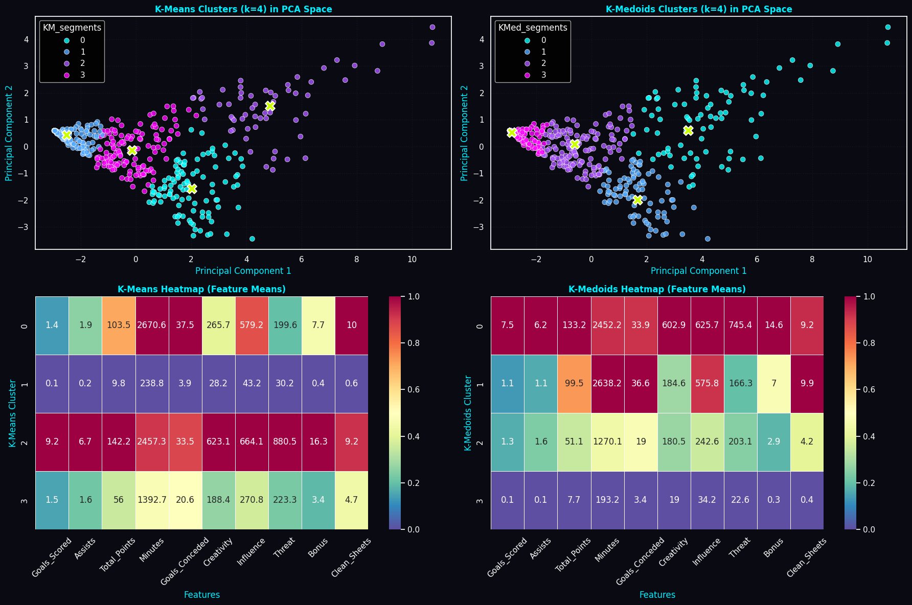

# Fantasy Sports Clustering Analysis

Unsupervised learning project segmenting English Premier League fantasy players into performance tiers, to support dynamic pricing on a fantasy sports platform (OnSports).

> This notebook previously lived inside the `adventure-works-profitability-analysis-SQL` repo by mistake. It has been moved here into its own dedicated repository.

## Context

Fantasy sports platforms let users draft virtual teams of real players, who earn fantasy points based on real-world match performance. OnSports, a fantasy sports platform, wants to use last season's Premier League data to set player prices for the upcoming season.

## Objective

Conduct a cluster analysis on player performance data (goals, assists, minutes, creativity, influence, threat, bonus points, clean sheets, etc.) to identify distinct player archetypes/tiers, which OnSports can use to set tiered pricing for the new season.

## Status: Work in progress

Completed so far:
- Data cleaning, exploratory data analysis (univariate + bivariate), and outlier review
- Feature scaling and PCA for dimensionality reduction
- K-Means clustering (k=4), with cluster profiling and visualizations
- K-Medoids clustering (k=4), with cluster profiling and a side-by-side comparison against K-Means

Pending:
- Hierarchical clustering (linkage/distance metric comparison, dendrograms)
- Gaussian Mixture Model clustering
- DBSCAN
- Final algorithm comparison and pricing recommendations

## Key finding so far: K-Means vs. K-Medoids

Both algorithms converge on the same four player tiers — elite offensive playmakers, durable defensive anchors, rotational/mid-tier regulars, and low-minute enablers — but K-Medoids anchors each cluster to a real player (e.g. Gylfi Sigurdsson, Ben Godfrey) instead of a synthetic mean, making it more robust to outliers and easier to interpret for pricing decisions.

*Top: 2D PCA projections of the K-Means and K-Medoids clusters (k=4), with centroids/medoids marked. Bottom: normalized feature-mean heatmaps per cluster for each algorithm.*

## Next steps

- Complete Hierarchical, GMM, and DBSCAN clustering
- Compare silhouette scores across all five methods
- Write up final pricing-tier recommendations for OnSports
